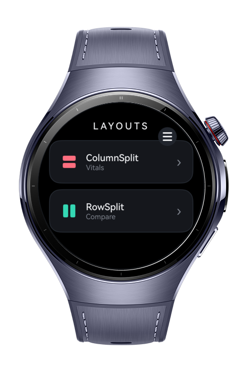
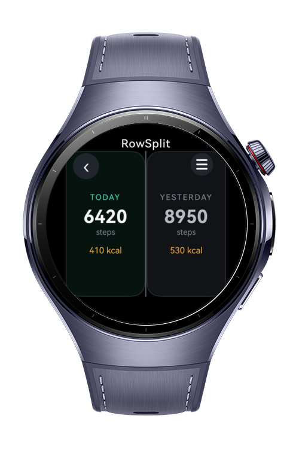
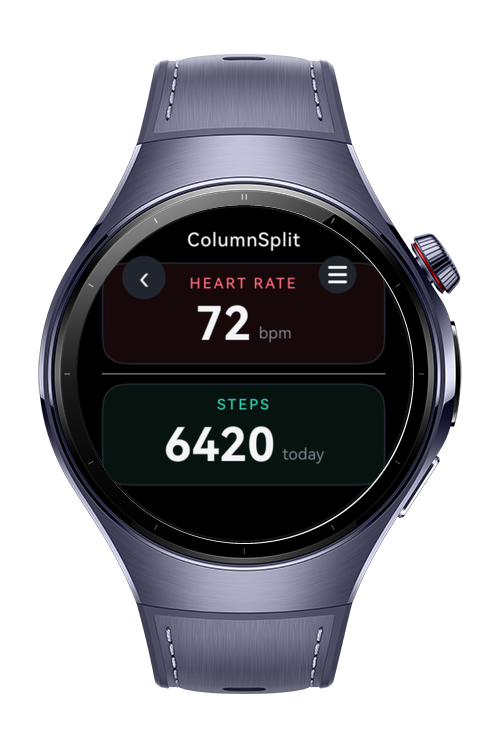
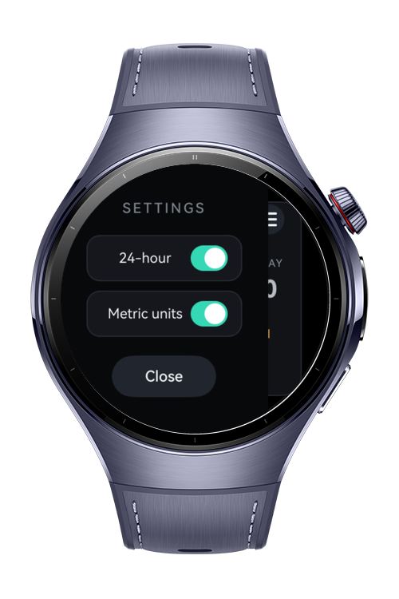

> **Note:** To access all shared projects, get information about environment setup, and view other guides, please visit [Explore-In-HMOS Index](https://github.com/Explore-In-HMOS/hmos-index).

# How to build split layout suite

A wearable showcase app for ArkUI layout containers. A round-screen home menu routes to one full-screen demo per
component, so each layout can be explored on its own: **ColumnSplit** and **RowSplit**. A global settings drawer is
hosted by a **SideBarContainer**.

# Preview

<div>
  
  
  
  
</div>

# Use Cases

- Browse a menu of ArkUI layout components and open each one as a full-screen demo.
- **ColumnSplit** — stack two panels vertically with a draggable horizontal divider.
- **RowSplit** — place two panels side by side with a draggable vertical divider.
- **SideBarContainer** — open a global settings drawer (24-hour and metric-unit toggles).
- Round-screen navigation — menu to detail with a back gesture, tuned for circular displays.

# Tech Stack

- **Languages**: ArkTS, ArkUI
- **Frameworks**: HarmonyOS SDK 5.1.0(18)+
- **Tools**: DevEco Studio Version 5.1.0.828+
- **Libraries**:
    - `@kit.ArkUI` (UI Components & Layouts)

### Key Technical Implementations

- `Navigation` + `NavPathStack` route the home menu to full-screen `NavDestination` pages without a route-map file.
- `ColumnSplit` and `RowSplit` use `resizeable(true)` with panel sizes kept under the container so the dividers stay
  draggable.
- `SideBarContainer` hosts a global settings drawer, opened by an overlay button and kept in sync with `showSideBar` /
  `onChange`.

# Directory Structure

```
LayoutShowcase
|--- entry/src/main/ets/
| |--- pages/
| | |--- Index.ets # Home menu and Navigation routing
| | |--- screenshots/ # UI Preview images for documentation
| |
| |--- view/
| | |--- VitalsColumnSplit.ets # ColumnSplit demo
| | |--- CompareRowSplit.ets # RowSplit demo
| | |--- SettingsDrawer.ets # SideBarContainer drawer content
| |
| |--- model/
| | |--- HealthData.ets # Sample metric data
| | |--- Theme.ets 
| |
| |--- resources/ # App icons, media, and raw assets
```

# Constraints and Restrictions

### Supported Device

* Huawei Watch 5
* Circular Screen Wearables (UI optimized via safe-area sizing and `.borderRadius` constraints)

# License

**LayoutShowcase** is distributed under the terms of the MIT License.
See the [LICENSE](./LICENSE) for more information.